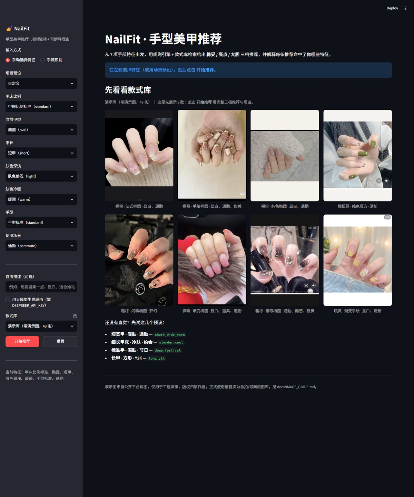

# NailFit — Hand-aware nail style recommendation

> 甲适 · 基于手部特征的美甲推荐
>
> 从手部照片提取甲型 / 甲长 / 肤色特征 → 规则引擎筛选 → 款式库检索 → 三档推荐 + 可解释理由

**核心立场：推荐结果只从款式库中挑选，不做生成式试戴。** 每一张推荐图都对应款式库中的真实条目，可溯源、可评测。



---

## 为什么不让大模型自由推荐

| 做法 | 结果 |
|---|---|
| 把 200 条款式和 20 条规则全塞进 prompt | 模型漏规则、无法单测、token 爆炸 |
| 让 VLM 看图后自由发挥 | "建议你试试奶茶色" ——正确但无用，且不可复现 |
| **规则决定推荐什么，模型只决定怎么说** | 可解释、可配置、可评测 |

---

## 架构

```
手照 ──► 特征提取 (MediaPipe + 规则 / Lab 色彩)
           │
           ▼
        HandFeatures {甲床比例, 甲型, 甲长, ITA°, 冷暖, 手型, 场景}
           │
           ├──► RuleEngine  硬过滤(排除不可行) + 加权打分
           ├──► 语义加权(可选, bge-m3)
           ▼
        Selector  三档(稳妥/亮点/大胆) + 色相去重
           │
           ▼
        Explainer  只生成理由与避雷(不产图)
           │
           ▼
        Validator  style_id 必须存在 + 三档不重复
```

## 目录

```
nailfit/
├── data/
│   ├── taxonomy.yaml        # 特征枚举 + 打分权重 + 多样性约束
│   ├── rules.yaml           # 匹配规则（改规则不改代码）
│   ├── styles.sample.json   # 款式库样例（15 条，替换成真实款式）
│   ├── styles.demo.json     # 演示款式库（43 条，autotag 自动生成，仅演示，schema v2）
│   └── media_cache.json     # 参考图缓存（prefetch 生成；缺失时卡片退化为纯文字）
├── core/
│   ├── data.py              # YAML / JSON 加载（文件缺失/损坏时报清晰错误）
│   ├── errors.py            # 统一异常：数据缺失 / 候选不足 / 契约失败
│   ├── features.py          # HandFeatures 数据契约 + 校验
│   ├── color.py             # sRGB → Lab → ITA°（肤色量化）
│   ├── landmarks.py         # 21 关键点 → 几何特征（启发式）
│   ├── rules.py             # 规则引擎：when / prefer / block
│   ├── selector.py          # 排序 + 三档 + 多样性
│   ├── styles.py            # 款式库校验（字段 / 枚举 / 唯一性 / 图片）
│   ├── labels.py            # 中文标签（特征名 / 甲型 / 场景）
│   ├── media.py             # 参考图解析：缓存 → 本地图 → 网络 Provider（Pexels / Openverse）→ 占位（M24/M26）
│   ├── retriever.py         # 可选语义加权（bge-m3）
│   ├── explainer.py         # LLM 生成理由（无 key 时模板降级）
│   ├── validator.py         # 输出契约校验
│   └── vision.py            # 手照 → MediaPipe 关键点 → 手部特征（M8，可选依赖）
├── api/
│   ├── main.py              # FastAPI 入口
│   ├── routes.py            # /api/recommend /api/styles /api/libraries /api/vision /api/health
│   └── schemas.py           # 请求/响应模型
├── app/
│   └── streamlit_app.py     # Streamlit 网页前端（可选依赖，见 requirements-frontend.txt）
├── scripts/
│   ├── demo.py              # 命令行跑通全链路（无需起服务）
│   ├── manual.py            # 手工录入 7 项手部特征 → 三张推荐卡
│   ├── validate_styles.py   # 款式库数据校验
│   ├── prepare_images.py    # 款式图批量裁切 / 缩放 / 压缩（≤300KB）
│   ├── vision_demo.py       # 手照 → 手部特征（M8，需 mediapipe）
│   ├── autotag.py           # 图片 → 结构化款式标签，生成演示款式库
│   ├── check_llm.py         # 解释层自检（M17：云端 Key / 本地 Ollama 联调）
│   ├── migrate_styles_v2.py # 款式库升级 schema v2：brand / description / search_query / media
│   ├── prefetch_media.py    # 预取参考图写缓存（local / Pexels；DeepSeek Search 实测无图）
│   ├── web_sources.py       # DeepSeek Search → 趋势 / 参考来源文本（不下载图片）
│   ├── openverse_candidates.py  # Openverse（免 Key CC）候选图清单：只产出候选、人工复核（M26）
│   ├── make_sample_images.py    # 样例库占位示意图：按色系/款式/甲型画 15 张（M27）
│   └── validate_media.py    # schema v2 媒体字段校验（授权 / 来源 / 图片存在）
├── tests/                   # pytest：规则 / 选择 / 校验 / 手工录入 / 款式库 / 图片处理 / 视觉层 / 评测 / 媒体层
├── eval/
│   ├── run.py               # 推荐质量评测（M18 五维 + M19 手照视觉层）
│   ├── cases.json           # 评测用例（8 条手工特征 + 17 条手照，共 25 条）
│   └── reports/             # 每次运行的 JSON 报告（gitignore）
├── models/                  # MediaPipe 模型缓存（gitignore，首次使用时自动下载）
├── raw_hands/               # 本地手照素材（gitignore）
├── static/styles/           # 款式图片（按 style id 命名；样例库 15 张占位图随仓库提交，可脚本重生成）
├── static/demo/             # 演示图片（不入库、不进 git，仅工程演示）
├── static/preview/          # 视觉层关键点标注图（gitignore）
├── .cache/                  # 联网候选图缓存（Openverse 等，gitignore）
└── docs/
    ├── design.md            # 设计说明
    ├── IMAGE_GUIDE.md       # 图片来源、选图标准与入库流程
    └── ROADMAP.md           # 剩余任务清单（M1–M28）
```

## 快速开始

```bash
# 1. 环境（建议 Python 3.11，mediapipe 暂不支持过新的版本）
python -m venv .venv
.venv\Scripts\activate
pip install -r requirements.txt
# 可选：视觉层（mediapipe，需要 Python 3.11/3.12）
# pip install -r requirements-vision.txt

# 2. 命令行跑通（不需要启动服务、不需要 API Key）
python scripts/demo.py

# 2.1 用 43 条款式库跑（M7 演示库，图片对应 static/demo/）
python scripts/demo.py --styles data/styles.demo.json --scenario slender_cool

# 3. 跑测试
pytest -q

# 3.1 推荐质量评测（M18 五维 + M19 视觉层，报告写到 eval/reports/）
python eval/run.py
python eval/run.py --vision             # 额外量手照识别（检测率 / 特征准确率）
python eval/run.py --styles data/styles.demo.json   # 换 43 条演示库跑

# 3.2 样例库占位图（M27，仓库已带 15 张；换库/删图后可重新生成）
python scripts/make_sample_images.py

# 4. 启动 API
uvicorn api.main:app --reload --port 8000
# Swagger: http://127.0.0.1:8000/docs

# 5. 网页前端（可选，Streamlit）
pip install -r requirements-frontend.txt
streamlit run app/streamlit_app.py
# 浏览器打开 http://localhost:8501

# 6. 手照识别（可选，需要 requirements-vision.txt；模型会在首次使用时自动下载）
python scripts/vision_demo.py --dir raw_hands

# 7. 大模型解释层（可选，M17）：把 .env 里的 DEEPSEEK_API_KEY 填好后
python scripts/check_llm.py     # 自检：3/3 条理由由模型生成且通过契约校验
python scripts/demo.py --llm    # 命令行用模型写理由（不配 Key 自动降级模板）

# 8. 参考图候选（可选，M26）：Openverse 免 Key CC 图源，本机需代理；只产出候选清单
python scripts/openverse_candidates.py --limit 5 --per-style 2 --proxy http://127.0.0.1:10090
```

---

## 演示：手工录入版（还不接视觉时怎么跑）

手照提取还没做，先用 7 项手工填写的特征跑完整推荐链路：

```bash
# 交互式录入：逐项选择，回车取默认值
python scripts/manual.py

# 直接给参数：一条命令出三张卡
python scripts/manual.py --bed short_wide --length short --ita light --warmth warm --hand fleshy --scene commute

# 场景预设：short_wide_warm / slender_cool / deep_festival / long_y2k
python scripts/manual.py --scenario deep_festival

# JSON 输出（接前端 / 评测脚本）
python scripts/manual.py --yes --json
```

输出示例：

```
==============================================================
NailFit · 推荐结果
==============================================================
特征：甲床偏短宽、椭圆、短甲、肤色偏浅、暖调、手型偏肉感、通勤
候选池：4 款可用 / 9 款被排除

[1] 奶茶裸粉 · 细法式  （safe 档，匹配度 0.92）
    图：static/styles/s001.jpg
    理由：甲床偏短宽，杏仁或椭圆甲型能拉长视觉比例；短甲优先选短甲友好款式，手绘与贴钻需要留长。
    命中规则：bed_short_wide / length_short / skin_light_warm

[2] 短甲猫眼 · 浆果  （highlight 档，匹配度 0.64）
    ...

避雷：
  - 「浆果紫 · 猫眼」该款式需要 mid 甲长，与当前甲长不匹配
```

参数说明：

| 参数 | 取值 | 说明 |
|---|---|---|
| `--bed` | `short_wide` / `standard` / `slender` | 甲床比例 |
| `--shape` | `round` / `square` / `oval` / `almond` / `squoval` | 当前甲型 |
| `--length` | `very_short` / `short` / `mid` / `long` | 当前甲长 |
| `--ita` | `light` / `mid` / `deep` | 肤色深浅 |
| `--warmth` | `warm` / `neutral` / `cool` | 肤色冷暖 |
| `--hand` | `slim` / `standard` / `fleshy` | 手型 |
| `--scene` | `commute` / `date` / `wedding` / `festival` / `cool` / `y2k` | 场景 |

其他参数：`--free-text "想要温柔显白"`（自由描述，参与语义加权）、`--llm`（有 Key 时用云端生成理由）、`--json`（机器可读）、`--interactive`（强制逐项填写）、`--yes`（用默认值，不反问）。

## 解释层（M17）：规则选款式，模型写理由

推荐结果始终由规则引擎决定，大模型只负责把「为什么适合」写得更像人话。模型不可用时自动降级为模板理由，**推荐结果本身不受影响**。

```bash
# .env（参考 .env.example）：DEEPSEEK_API_KEY=sk-xxx
python scripts/check_llm.py      # 自检：读 .env → 调云端 → 打印 3 条理由与校验结果（退出码 0 = 可用）
python scripts/demo.py --llm     # 命令行：加 --llm 即开启
python scripts/manual.py --llm   # 手工录入版同样支持
```

- **触发条件**：`use_llm=true` 且配置了 `DEEPSEEK_API_KEY`。API 请求的 `use_llm` 字段默认 `true`，前端开关默认关闭（避免误调用）。
- **输出清洗（防幻觉）**：`style_id` 必须逐字来自候选；`reason` 非空且 ≤160 字（超长截断）；`caution` ≤60 字；`avoid` ≤2 条、每条 ≤60 字。缺条目/调用失败 → **逐条回退模板**。
- **自动补一次**：第一次返回不齐时，把缺失的 `style_id` 反馈给模型重试一次；第二次仍失败就用第一次已通过校验的部分。
- **状态可追溯**：响应里 `meta.explainer = {mode, model, degraded, llm_cards, error}`；命令行会打印「理由：大模型生成（deepseek-chat，3/3 条）」或降级原因。
- **本地联调（不花云端 Key）**：Ollama 的 OpenAI 兼容端点也能跑整条链路：

  ```bash
  python scripts/check_llm.py --base-url http://127.0.0.1:11434/v1 --model deepseek-r1:7b
  ```

  小模型质量有限（实测 2–3/3 条通过校验），只用于验证接入与降级逻辑；正式演示用云端 DeepSeek。

**实测结果（2026-10-23，云端 `deepseek-chat`）**：3/3 条理由由模型生成且全部通过契约校验，无降级。样例：

> 奶茶裸粉配细法式在短甲上留白少，不会截断甲面，椭圆或方圆形修甲能顺着偏短宽的甲床拉出纵向比例；暖调浅肤上裸粉不发灰，通勤也干净不抢眼。

Key 放在系统环境变量 `DEEPSEEK_API_KEY`（或项目根目录 `.env`）均可，`check_llm.py` / API / 前端共用同一份配置。

## 推荐质量评测（M18 / M19）

推荐得「对不对」不能只靠肉眼抽查。`eval/run.py` 把一批人工标注的用例跑一遍，量化五个维度；`--vision` 再把手照识别接进同一份报告：

```bash
python eval/run.py                      # 跑 eval/cases.json（25 条），3 次重复
python eval/run.py --vision             # 额外量手照视觉层：检测率 / 特征准确率
python eval/run.py --llm --llm-cases 3  # 额外量解释层（LLM 有效条数 / 降级 / 耗时）
python eval/run.py --strict             # 合理性低于阈值返回非 0（CI 用）
python eval/run.py --styles data/styles.demo.json   # 换 43 条演示库跑
```

| 维度 | 口径 | 当前结果（样例库 15 条，2026-10-23） |
| --- | --- | --- |
| 契约 contract | 3 条推荐、id 存在、色系不重复、理由非空且 ≤160 字、档位合法 | 100% |
| 合理性 fit | safe 档（主推荐）的 tone / value / shape 与人工期望一致；禁止项对所有档位生效 | 100%（25/25 用例） |
| 多样性 diversity | 色相圆形间隔 ≥ `min_hue_gap`、三档覆盖 | 100%，三档覆盖均值 3.00 |
| 稳定性 stability | 重复运行 top-1 一致率；单特征抖动一档时 top-1 变化率 | 稳定 100%，抖动 16% |
| 视觉层（`--vision`） | 17 条手照用例：检测率 + 自动特征 vs 人工标注 | 检测 88%（15/17）；肤色 73%、甲床 100%、甲型 71%、甲长 100%、手型 50% |
| 解释层（可选） | LLM 有效条数 / 降级例数 / 平均耗时 | `--llm` 时输出 |

用例文件 `eval/cases.json` 每条 = 7 项手部特征 + 人工期望（tone / value / shape / 禁止项）。M18 首轮评测曾暴露 3 条规则/数据缺口，已在「补规则缺口」中修复：

1. 冷调浅肤仍把暖色裸粉（s001）排进 safe 档 → `skin_light_cool` 权重 1.0→2.0、`tone` 增加 `neutral`，并新增 `skin_mid_cool`；
2. Y2K/冷调场景提不上金属/镜面类 → 样例库补 `s014 冷灰蓝·纯色`、`s015 深莓·猫眼`（13→15 条）；
3. 深肤不分冷暖、value 没有下限 → 拆成 `skin_deep_warm` / `skin_deep_cool` / `skin_deep_neutral`，`value` 加中深色下限。

修复后 8/8 手工用例全部通过，`known_gap` 计数为 0（机制保留，供继续标注新缺口）。

**M19 扩评测集**：在 8 条手工特征用例之上，补了 **17 条真实手照用例**（`source: hand_photo` + `image`，两位被摄者的自然握持/标准手背照），case 期望由人工标注。新增 `--vision` 指标同时回答两件事：
- 视觉层能不能用：17 张里 15 张检测到手（2 张未检测到）；肤色/甲床/甲长最稳，手型最不稳（50%），符合“自然握拳下手型信息不足”的预期；
- 推荐层在演示库上的表现：43 条演示库（autotag 生成）跑出**契约 100%、合理性 92%、多样性 12%**——合理性 2 条失败与多样性偏低都来自 autotag 的标签噪声（演示库 `tone`/`hue` 由主色估计，暖区扎堆），不是推荐逻辑回归；同时 M19 的演示库评测暴露并修掉了一个真实的契约 bug：候选色相太挤时放宽步骤会选出同色系，现改为“放宽色相但仍禁止同色系”。


## 网页前端（Streamlit，M14）

命令行之外，也给了一个可交互的网页版本：**手照识别** 或 **手工填 7 项特征**，右侧出三张推荐卡。

```bash
pip install -r requirements-frontend.txt   # 只装前端依赖，不影响核心测试
streamlit run app/streamlit_app.py         # 默认 http://localhost:8501
```

页面能力：

- 输入方式切换：**手照识别**（上传手照 → 自动提特征）或 **手动选择特征**
- 首页图廊：还没开始推荐时，先展示当前款式库 8 张款式图（缺图的自动跳过），避免打开页面一片空白
- 手照识别：模型未下载时页面内一键下载；上传后展示质量、左右手、手势、ITA°，不可靠字段用下拉手动补（M11 回退）
- 场景预设（短宽暖皮 / 纤细冷皮 / 浓郁节日 / 长甲 y2k）+ 7 个下拉逐个微调
- 自由描述（参与语义加权）与「用大模型生成理由」开关（需 `DEEPSEEK_API_KEY`）
- 款式库切换：样例库（15 条，占位示意图）/ 演示库（43 条，真实截图）；启动时调 `GET /api/libraries` 自动选图齐全的演示库，缺图时提示并退回样例库
- 图片授权标注：演示素材 / 示意占位图 · 非真实款式 / 授权待确认，来源链接可点击
- 无 Key 时（`GET /api/health` 的 `llm_configured=false`）大模型理由开关自动置灰，推荐降级为模板理由
- 三张卡展示：图片、档位、匹配度、推荐理由、避雷提示、命中规则
- 「查看原始 JSON」便于调试和接下游，并可下载 JSON 文件

前端只负责布局，特征校验、推荐编排、视图整理分别复用 `core.features` / `core.pipeline` / `core.ui_view`，手照识别复用 `core.vision`，和 CLI、FastAPI 行为一致。`tests/test_frontend.py` 用 Streamlit 官方 `AppTest` 做冒烟测试，没装 streamlit 时自动跳过。

### Vue 3 前端（M28，独立目录）

Streamlit 版偏演示/调试；面试或对外展示用独立的 Vue 前端，放在仓库外的 `naifit-fonted/`（Vue 3 + Vite + TypeScript，无 UI 框架依赖）：

```bash
cd ../naifit-fonted
npm install        # 或 pnpm install
npm run dev        # http://127.0.0.1:5173，/api、/static 自动代理到后端 8000
npm run build      # 产物在 dist/
```

- 页面：推荐工作台（7 项特征 + 快捷预设 + 款式库切换 + 手照上传识别 + 三档结果卡 + 完整 JSON 下载）、款式库页（43/15 款全量浏览 + 色系/款式筛选）
- 图片走同源 `/static/...`（后端已挂载 `StaticFiles`），不再依赖 Streamlit 的静态文件服务
- 后端为此新增 `POST /api/vision/upload`（直接上传图片字节，临时目录识别后清理）、`GET /api/styles?library=sample|demo`、`POST /api/recommend` 的 `library` 字段；接口响应与 Streamlit 版一致

## 款式库校验

给 `data/styles.json` 打标前/后都跑一遍，避免脏数据进推荐链路：

```bash
# 字段完整性 + 枚举合法性 + id 唯一性
python scripts/validate_styles.py

# 额外检查图片是否存在（打图阶段用）
python scripts/validate_styles.py --check-images

# 校验真实款式库（默认读 data/styles.sample.json）
python scripts/validate_styles.py --styles data/styles.json
```

### 参考图媒体层（M24）

推荐结果要展示「款式参考图 + 来源」，但推荐请求**不联网**：联网找图只在预取脚本里发生，抓到的图写进缓存，展示层只读缓存 / 本地图，毫秒级且可复现。

```bash
# 1) 款式库升级到 schema v2（brand / description / search_query / media，幂等，可重复跑）
python scripts/migrate_styles_v2.py --styles data/styles.demo.json

# 2) 预取参考图：先把图放进 static/ 用 local；有 Key 再开网络 Provider
python scripts/prefetch_media.py --check                     # 只查覆盖率，不联网
python scripts/prefetch_media.py --provider local            # 本地图写进 data/media_cache.json
python scripts/prefetch_media.py --provider pexels --limit 10   # 需 PEXELS_API_KEY（可商用图库）
python scripts/prefetch_media.py --provider search --limit 10   # 实验性：需 DEEPSEEK_API_KEY

# 3) 校验 schema v2 + 授权标注 + 图片存在
python scripts/validate_media.py --check-images

# 4) 可选：用 DeepSeek Search 拉趋势 / 参考来源文本（不下载图片）
python scripts/web_sources.py --query "2026 美甲流行趋势" --count 3
```

**网络抓图实测结论（2026-10-26，真实 DeepSeek Key）**：Search 接口正常返回（`title` / `url` / `site_name` / `date` / `summary` / `authority` / `rerank_score`），但 **Fetch 返回的 Markdown 只有正文、不含图片**（8 个页面 0 命中，含 Wikipedia/WikiHow 这类图多的站点），部分站点还会 404 或 ReadTimeout。因此网络图片改由 Pexels / Unsplash（需各自 Key；本机实测 API 可达）或本地图库承担；DeepSeek Search 只用于「当前流行什么 / 出处在哪里」的文本证据（`scripts/web_sources.py`）。

解析顺序是 `data/media_cache.json`（未过期）→ `static/` 本地图 → 网络 Provider（仅 prefetch）→ 占位。没图的款式不会阻塞推荐：卡片退化为纯文字，前端显示「暂无参考图 · 仅展示文字推荐」。每张图都带 `license` / `source_url`，前端统一标注「仅风格参考，非本手模拟效果」。

#### 样例库占位图（M27）

`data/styles.sample.json` 的 15 条示例款式原本指向 `static/styles/s00x.jpg`，但仓库里没有图 —— 切到「样例库」时卡片全是空白。现在用纯 PIL（无新依赖）按标签画**占位示意图**：色系决定配色、款式决定纹样（法式/猫眼/渐变/棋盘格…）、甲型决定甲片形状，图上有明确「样例库占位示意图 · 非真实款式」标注。

```bash
python scripts/make_sample_images.py            # 只补缺图（幂等，已有图跳过）
python scripts/make_sample_images.py --force    # 全部重画
python scripts/make_sample_images.py --dry-run  # 只统计要生成哪些
```

15 张占位图（768×1024）随仓库提交，克隆下来即可看到完整页面；生成逻辑在 `scripts/make_sample_images.py`，`tests/test_openverse_media.py` 校验尺寸与幂等。

#### Openverse 候选图（M26）

Pexels 注册暂停、DeepSeek Fetch 又不返回图片，所以补了一个**免 Key** 的 CC 图源 [Openverse](https://openverse.org)（Flickr / Wikimedia / 博物馆等开放许可图片）。它只产出**候选清单**，不自动进推荐链路 —— 款式对不对、清不清晰要人看一眼：

```bash
# 本机访问 Openverse 需要代理；限定前 5 款、每条最多 2 张
python scripts/openverse_candidates.py --limit 5 --per-style 2 --proxy http://127.0.0.1:10090
```

产物：`.cache/openverse/<style_id>/<rank>.jpg`（候选图）+ `.cache/openverse/candidates.json`（含 title / creator / CC 许可 / 来源页 / 相关性 / 复核状态）。内置三道过滤：CC0·PDM·BY·BY-SA 许可白名单、长边 ≥600px、标题或 tags 必须出现美甲词；长查询常 0 结果，所以用「色系 + 款式 + 甲型」拼短查询并逐级降级（`openverse_queries()`）。人工复核通过后，再把 `media.image` / `license: openverse` / `source_url` 写进款式库。

### 自动打标签（M7）

M7 要的是“图片 → 结构化标签”。正式库人工复核前，先用 `scripts/autotag.py` 从演示图生成一份可跑的演示库：

```bash
# 从 static/demo 的 43 张图生成 data/styles.demo.json
python scripts/autotag.py

# 只看看会生成什么，不写文件
python scripts/autotag.py --dry-run

# 校验 + 确认图片都在
python scripts/validate_styles.py --styles data/styles.demo.json --check-images

# 用演示库跑推荐（4 个场景都能出三张卡）
python scripts/demo.py --styles data/styles.demo.json --scenario slender_cool
```

颜色维度（hue / color_family / tone / value / saturation）从图片主色计算；形状、工艺、长度、场景从文件名关键词推测。想人工修正，把字段写进 `data/demo_labels.json`（id → 字段），再 `python scripts/autotag.py --overrides data/demo_labels.json`。

### 视觉层：手照 → 手部特征（M8/M9）

装好 mediapipe 后，用 `scripts/vision_demo.py` 把一张手照变成和手工录入同口径的特征（模型缺失时会自动下载到 `models/`，约 8MB）：

```bash
# 单张 / 整个目录（raw_hands/ 里的手照已被 gitignore）
python scripts/vision_demo.py raw_hands/hand01_right_01.jpg
python scripts/vision_demo.py --dir raw_hands

# 不想自动下载时加 --no-download
python scripts/vision_demo.py --dir raw_hands --no-download

# 输出 JSON（接 API / 攒评测集）
python scripts/vision_demo.py --dir raw_hands --json out_hands.json
```

输出：左右手、手势、肤色（ITA° → `ita_band`/`warmth`）、甲床比例/甲型/甲长/手型，以及每项的置信度和原始几何量；同时在 `static/preview/` 生成关键点标注图。

手照直接出推荐（M9）有三条入口，行为一致：`core.pipeline.recommend_from_image()`、`POST /api/recommend/from-image`、Streamlit 前端「手照识别」。

**拍图规范（按省事程度排，前两种就能全自动）**：

1. **最省事（推荐）**：手背朝上平放在桌面/腿上，手机从正上方拍。手指自然并拢或微开都行，不用刻意把指甲怼向镜头。
2. **自然展开**：手背朝向镜头、手指自然伸开站着拍（指尖略朝上）；整只手入画，占画面 ≥ 15%。
3. **随手角度（握拳、展示美甲）**：也能用——自动出肤色，甲床比例/甲型/甲长/手型在页面上用下拉补选即可（M11），不需要重拍。
4. 光线均匀，避免逆光和强反光。

**分级质量门槛**（`core/vision.py: quality_gate`）：`ok`（平放/自然展开，7 项全自动）→ `relaxed`（手略扣，只出肤色）→ `clenched`（握拳/展示角度，只出肤色）→ `pose`（手朝镜头、透视过重）→ `low`（手太小/置信度低）。不用摆标准手势：手势模型给 `Open_Palm` 或几何伸展度 ≥ 0.88 都算 `ok`。

**M12 第一版校准（2026-10-23）**：用 6 张「手背平放、正上方」的标准手照实测：

- 像素量测路径：GrabCut 整手掩膜（关键点骨架做前景种子）→ 垂直手指轴向双向量宽 → 三指中位数剔离群值；甲板长 ≈ DIP→指尖 × 0.85，甲宽 ≈ 该处指宽 × 0.85（`core/vision.py: NAIL_LENGTH_FACTOR / NAIL_WIDTH_FACTOR`）。
- 6 张结果自洽：`aspect` 0.77–0.86、`taper` 0.84–0.91，6/6 判 `ok`；阈值据此定为 `NAIL_BED_THRESHOLDS=(0.72, 0.95)`、`TAPER_ALMOND=0.78`、`TAPER_SQUARE=0.92`、`HAND_TYPE_THRESHOLDS=(0.88, 1.05)`（同一只手 2D 掌宽/掌长会波动 ±0.09，所以手型只做宽档判断）。
- 量测异常（单指宽 > 图宽 22%，或 aspect/taper 超出 0.4–1.6）会自动丢弃，按「不可靠」处理，交给下拉补选。

已知限制：甲长/甲型/甲床比例是基于指节几何的**估算**，不是真实的甲板分割；手型可能在相邻档之间跳 ±1 档。要在**任意角度全自动**量甲面，需要训练一个「甲面分割模型」（要标注数据，记在后续可选任务），不是这版范围。正式校准建议攒 20–30 张多手照片再跑一轮。

---

## API

### `POST /api/recommend`

```json
{
  "features": {
    "nail_bed_ratio": "short_wide",
    "length": "short",
    "ita_band": "light",
    "warmth": "warm",
    "hand_type": "fleshy",
    "scene": "commute"
  },
  "free_text": "想要温柔一点、显白",
  "use_llm": true,
  "library": "sample"
}
```

返回三张推荐卡（含 `matched_rules` 与 `reason`）、以及 `avoid` 避雷提示。`library` 可选 `sample`（默认，15 款样例/占位图）或 `demo`（43 款演示库/真实截图），未知库名返回 `422`。

### `GET /api/styles`
款式库列表（用于前端展示与调试）。库为空或数据损坏时返回 `503`；`library` 查询参数可选 `sample`（默认）/ `demo`，未知库名返回 `422`。

```bash
curl 'http://127.0.0.1:8000/api/styles?library=demo'   # 43 款演示库
curl 'http://127.0.0.1:8000/api/styles'                # 15 款样例库（默认）
```

### `GET /api/libraries`

可选款式库 + 图片齐全度（Vue 前端据此自动选择默认库）：

```bash
curl 'http://127.0.0.1:8000/api/libraries'
```

```json
{
  "default": "sample",
  "libraries": [
    {"name": "demo", "count": 43, "available": true, "images_ready": true, "missing_images": 0},
    {"name": "sample", "count": 15, "available": true, "images_ready": true, "missing_images": 0}
  ]
}
```

规则：优先演示库（真实截图），`images_ready` 为 false 时前端禁用该库并提示重跑
`scripts/prepare_images.py`；都没图时退回样例库占位图。

### `GET /api/health`

```json
{"status": "ok", "service": "nailfit", "llm_configured": true}
```

`llm_configured` 表示后端是否配置了 `DEEPSEEK_API_KEY`：false 时前端会把「用大模型生成理由」置灰，
推荐仍可用（自动降级为模板理由）。

### `POST /api/vision/extract`（M8/M9）

手照路径 → 手部特征（只识别，不推荐）：

```json
{
  "image_path": "raw_hands/hand01_right_01.jpg",
  "scene": "commute",
  "overrides": {"nail_shape": "oval"},
  "auto_download": false
}
```

返回 `features`、`quality`（`ok` / `relaxed` / `clenched` / `pose` / `low`）、`handedness`、`gesture`、`confidences`、`unreliable`（不可靠/缺失字段）、`notes`、`ita_degrees`、`metrics`、`preview`（关键点标注图路径）。

### `POST /api/recommend/from-image`（M9）

手照直接出三张推荐卡（响应在 `POST /api/recommend` 基础上多一个 `vision` 元信息）。照片质量不达标或缺特征时返回 `422`，提示可用下拉补选，或改用 `POST /api/recommend` 手工补齐。

> 说明：当前 `image_path` 是本地路径，只适合本机演示；公网部署时应改成上传接口并加鉴权。

### `POST /api/vision/upload`（M28）

给浏览器前端用的直传接口：请求体直接是图片字节（`Content-Type: image/jpeg` 等），查询参数 `scene` / `auto_download`，后端落临时文件识别后即删。返回结构与 `/api/vision/extract` 相同（容器里无 `raw_hands/` 也能用）。

```bash
curl -X POST --data-binary @hand.jpg \
  -H 'Content-Type: image/jpeg' \
  'http://127.0.0.1:8000/api/vision/upload?scene=commute'
```

空请求体返回 `422`，超过 12 MB 返回 `413`，识别失败返回 `422`。

## 错误处理

所有失败路径都返回**一行能看懂的中文原因**，不用翻 traceback：

| 场景 | CLI 表现 | API 表现 |
|---|---|---|
| 特征值非法（如 `length=eternal`） | `特征非法：...`，退出码 1 | `422`，`detail` 说明哪个字段不合法 |
| 款式库文件缺失 / JSON 损坏 | `✗ 推荐失败：...`，退出码 2 | `503`，`款式库不可用: ...` |
| 款式库为空（`styles: []`） | 同上 | `503`，`款式库不可用: ...` |
| 款式库名未知（如 `library=nope`） | — | `422`，`detail` 列出可选库名 |
| 规则过滤后无候选 | `✗ 推荐失败：没有通过硬性过滤的款式...` | `422`，`无法生成推荐: ...` |
| 过滤后不足 3 款（凑不齐三档） | 同上 | `422`，`过滤后只剩 N 款，至少需要 3 款` |
| 手照没检测到手 / 模型缺失 | `✗ ...`，退出码 2 | `422`，`手照识别失败: ...` |
| 手照是随手角度（握拳/半握） | 只输出肤色，甲面字段标「不可靠」，前端下拉补选即可 | `422`，`手照信息不足: ...`，提示补选或手工补齐 |
| 输出契约失败（模型编了不存在的款式） | `✗ 推荐失败：...` | `502`，`推荐结果校验失败: ...` |
| 大模型不可用 / 没配 Key / 超时 | **不报错**，理由自动降级为模板；`meta.explainer.degraded=true`，命令行打印原因 | 同左（HTTP 200，`meta.explainer` 标注） |

自测这些边界（不需要真实数据）：

```bash
python scripts/demo.py                            # 正常路径
python scripts/validate_styles.py --check-images  # 数据完整性
pytest -q tests/test_edge_cases.py -v             # 14 个边界用例
```

## 数据契约

`styles.sample.json` 每条款式：

| 字段 | 说明 |
|---|---|
| `id` | 唯一 ID，与图片文件名一致 |
| `shape` | 推荐甲型列表（杏仁/椭圆/方圆形…） |
| `color_family` / `tone` / `value` / `saturation` | 色彩属性 |
| `style` | 款式（纯色/法式/渐变/猫眼/手绘…） |
| `length_fit` | 该款式所需的最短甲长 |
| `nail_bed_fit` | 适配的甲床类型 |
| `scene` | 适用场景 |
| `hue` | 色相角（0–360），用于三档去重 |
| `tags` | 自由标签（显白/通勤/温柔…） |

`data/styles.demo.json` 是同一 schema 的 43 条演示库（`autotag` 生成，额外带 `autotag: true` 与 `name`，图片指向 `static/demo/`），只用于工程演示；正式库仍为 `data/styles.json`。

### schema v2（M24，参考图媒体层）

`styles.demo.json` 已升级为 `version: 2`，每条在原有字段外追加：

| 字段 | 说明 |
|---|---|
| `brand` | 来源/品牌占位（演示库为「演示素材」） |
| `description` | 款式的中文描述（展示与检索用） |
| `search_query` | 联网找参考图时用的查询词（中文短句） |
| `media` | `{image, source_url, license, provider, relevance, fetched_at, verified, note}` |

`media.license` 取值：`demo`（本地演示图）/ `self`（自摄或自有授权）/ `pexels` / `unsplash`（可商用图库）/ `openverse`（Openverse CC 候选，人工复核后入库）/ `unknown`（公开网页，商用前必须确认授权）/ `placeholder`（占位示意图：有图但不是真实款式；无图时卡片退化为文字）。非本地授权必须带 `source_url`。前端标注规则：`demo` → 「工程演示素材」，`placeholder` → 「示意占位图 · 非真实款式」，其余 → 「仅风格参考，非本手模拟效果」。

媒体缓存 `data/media_cache.json` 结构：`{version, updated_at, items: {style_id: media}}`，由 `prefetch_media.py` 生成，可随项目分发以复现演示效果。

## 评测（M18 / M19 已完成）

- ✅ 25 条用例（8 手工特征 + 17 手照）的契约 / 合理性 / 多样性 / 稳定性，见「推荐质量评测」
- ✅ 视觉层检测率与特征准确率（`--vision`）
- 待办：单条样式级「用户真实反馈」，以及正式款式库上的评测（演示库标签噪声大，只作参考）

## 图片来源

正式款式库优先用**自拍 / 可商用图库**（Pexels、Unsplash 等）；小红书等平台截图只作本地演示参考，版权归原作者。
没有图库 Key 时，可用 `scripts/openverse_candidates.py` 从 [Openverse](https://openverse.org) 拉 CC0/PDM/BY/BY-SA 候选图（只产出候选清单，人工复核并保留 `creator` / `license` / `source_url` 后才能入库）。
完整规范（授权优先级、选图标准、裁剪压缩、免责声明）见 [docs/IMAGE_GUIDE.md](docs/IMAGE_GUIDE.md)。

另有 43 张处理好的**演示图**在 `static/demo/`（来源为平台截图，仅工程演示：README 截图 / 前端占位 / 面试示意；**不登记进款式库、不进 git**）。映射表与逐张处理命令见 IMAGE_GUIDE 第 6 节。

处理命令：

```bash
# 原图放 raw_images/ → 自动裁 3:4、压到 ≤300KB → 输出 static/styles/
python scripts/prepare_images.py --src raw_images --out static/styles --prefix s --start 14

# 截图类：先用 --box 框掉状态栏/评论区；宽图用 --fit pad 补边
python scripts/prepare_images.py --src raw_images/0816.jpg --out static/styles/s014.jpg --box 0,400,1206,2008

# 校验图片是否齐
python scripts/validate_styles.py --check-images
```

> 页面需标注：**「风格参考，非本手模拟效果」**。若使用公开平台图片，请同时注明来源与非商用声明，并准备随时替换。

## License

MIT
